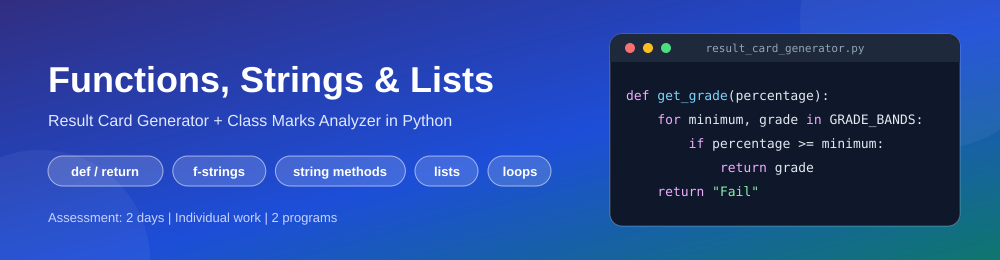
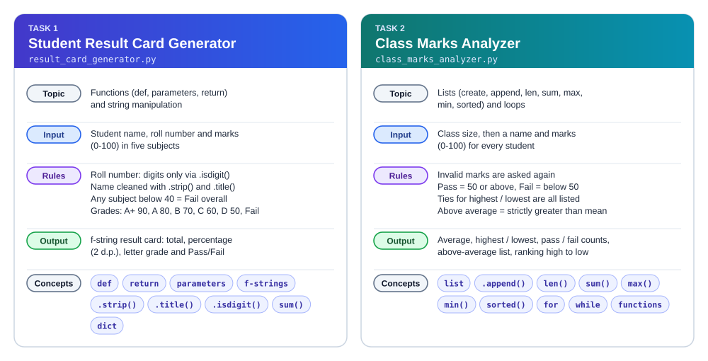
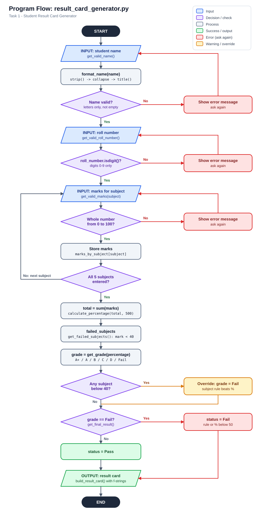
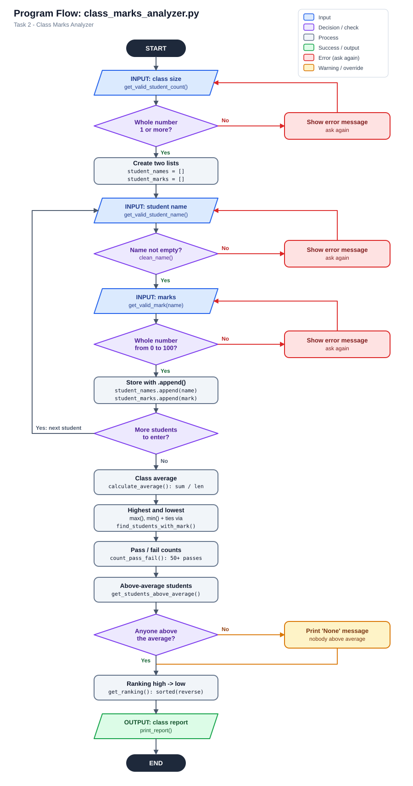
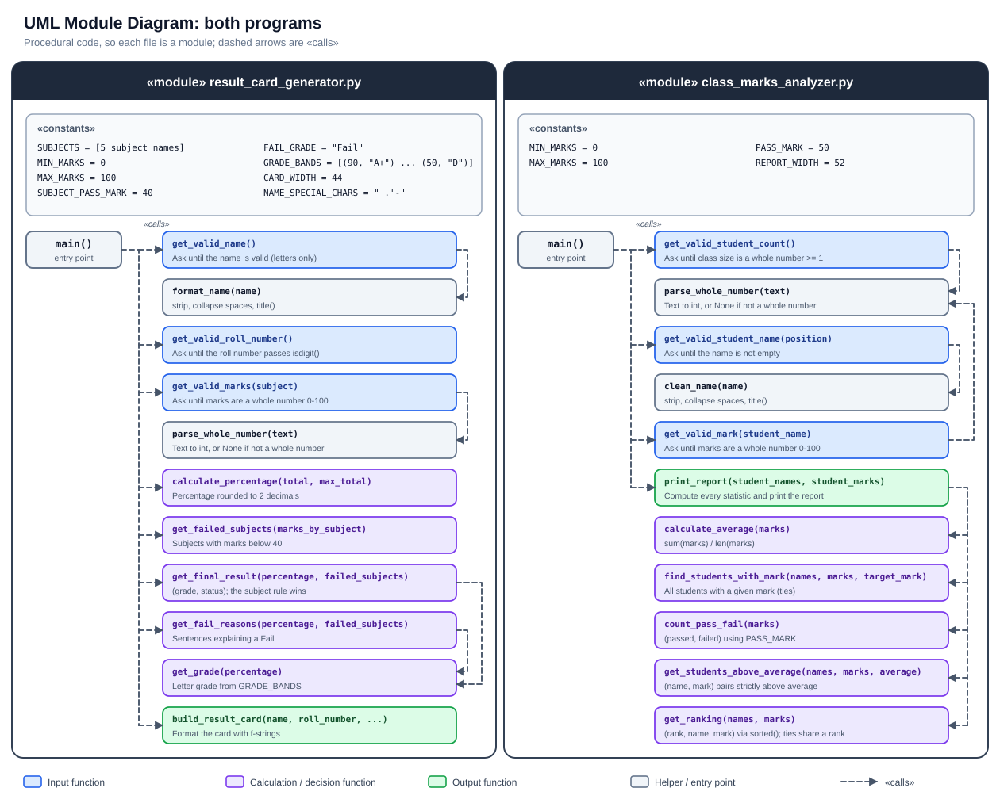

<p align="center"></p>

# Python Assessment: Functions, Strings and Lists

Two separate Python programs for the *Functions, Strings and Lists* assessment: a **student result card generator** (functions and string handling) and a **class marks analyzer** (lists and loops). Both validate every input, are split into small documented functions, and were tested with normal, boundary and invalid inputs.

**Contents:** [Overview](#1-project-overview) · [Folder Structure](#2-folder-structure) · [Task 1](#3-task-1-student-result-card-generator) · [Task 2](#4-task-2-class-marks-analyzer) · [UML](#5-uml-diagram) · [Concepts](#6-concepts-and-techniques-used) · [How to Run](#7-how-to-run) · [Sample Execution](#8-sample-execution) · [Test Cases](#9-test-cases) · [References](#references)

## 1. Project Overview

| Task | File | Topics | What it does |
|---|---|---|---|
| 1 | `result_card_generator.py` | Functions (`def`, parameters, `return`), string manipulation | Reads one student's name, roll number and five marks, then prints a graded result card. |
| 2 | `class_marks_analyzer.py` | Lists (`append`, `len`, `sum`, `max`, `min`, `sorted`), loops | Reads names and marks for a whole class and prints statistics, pass/fail counts and a ranking. |

<p align="center"></p>

## 2. Folder Structure

```text
python-functions-lists-assessment/
├── assets/
│   ├── banner.svg
│   ├── class_analyzer_flow.svg
│   ├── overview.svg
│   ├── result_card_flow.svg
│   └── uml_diagram.svg
├── class_marks_analyzer.py
├── README.md
└── result_card_generator.py
```

> `assets/` holds only the images used in this README. The two programs and the README sit in the repository root exactly as the brief requires.

## 3. Task 1: Student Result Card Generator

**File:** `result_card_generator.py` · **Topics:** functions and string manipulation

### Summary

The program asks for a student's name, roll number and marks in five subjects (English, Mathematics, Science, Computer Science, Social Studies). Small functions validate the input, clean the name, calculate the percentage and choose the grade. A final function builds the result card with f-strings.

### Rules and requirements

- Marks must be whole numbers from **0 to 100**; the program asks again until they are.
- The roll number must contain digits only, checked with `.isdigit()`.
- The name is cleaned with `.strip()` and `.title()` (inner extra spaces are collapsed too).
- Grades come from the overall percentage:

| Percentage | Grade |
|---|---|
| 90 and above | A+ |
| 80 to below 90 | A |
| 70 to below 80 | B |
| 60 to below 70 | C |
| 50 to below 60 | D |
| Below 50 | Fail |

- **If any subject mark is below 40, the final result is Fail, whatever the percentage.** In that case the card shows grade `Fail` and lists the reason under *Remarks*.
- The card shows name, roll number, all five marks, total, percentage (2 decimals), grade and final status (Pass/Fail).
- Design decisions: marks are whole numbers; percentage bands use "greater than or equal" so 89.80 % is **A** (not a gap between 89 and 90).

### Program Flow

<p align="center"></p>

### Code Methods Description

| Method or section | Purpose |
|---|---|
| Constants | SUBJECTS, MIN_MARKS, MAX_MARKS, SUBJECT_PASS_MARK, FAIL_GRADE, GRADE_BANDS, CARD_WIDTH, NAME_SPECIAL_CHARS replace magic numbers. |
| `parse_whole_number(text)` | Converts text to an int, or returns None if it is not a plain whole number (rejects 1_0, 85.5 and look-alike digits). |
| `format_name(name)` | Cleans a name with .strip(), collapses inner spaces and applies .title(). |
| `get_valid_name()` | Loops until the cleaned name is non-empty and contains only letters and . ' - or spaces. |
| `get_valid_roll_number()` | Loops until the roll number passes .isdigit() (and is ASCII); returns it as text to keep leading zeros. |
| `get_valid_marks(subject)` | Loops until the marks for one subject are a whole number from 0 to 100; returns the int. |
| `calculate_percentage(total, max_total)` | Returns total / max_total x 100 rounded to 2 decimals; raises ValueError if max_total is not positive. |
| `get_grade(percentage)` | Returns A+, A, B, C, D or Fail from the GRADE_BANDS table; raises ValueError outside 0-100. |
| `get_failed_subjects(marks_by_subject)` | Returns the subjects whose marks are below 40 (list comprehension). |
| `get_final_result(percentage, failed_subjects)` | Returns (grade, status); any failed subject forces Fail regardless of the percentage. |
| `get_fail_reasons(percentage, failed_subjects)` | Returns plain sentences explaining why a student failed, for the Remarks section. |
| `build_result_card(...)` | Builds the whole card with f-strings (alignment, :.2f) and returns it as one string. |
| `main()` | Runs the program: input, calculation, then prints the card. |

### Input Validation

| Input | Rule | On invalid input |
|---|---|---|
| Name | Not empty after cleaning; letters plus spaces and `. ' -` only | `Invalid name: use letters (and spaces, . ' -) only. Please try again.` |
| Roll number | `.isdigit()` and ASCII, so digits 0-9 only | `Invalid roll number: digits only (0-9). Please try again.` |
| Marks (each subject) | Whole number from 0 to 100 | `Invalid input: 'abc' is not a whole number.` or `Invalid marks: 101 is outside 0-100.` then asks again |
| Ctrl+C / Ctrl+D | Cancelling mid-input | Prints `Input cancelled...` and exits without a traceback |

### Expected Results

- **Pass:** every subject is 40 or above **and** the percentage is 50 or above, so the grade is A+, A, B, C or D and the status is Pass.
- **Fail:** any subject below 40, or a percentage below 50, so the grade and status are both Fail and the reasons are listed.
- Invalid input never crashes the program; it prints a message and asks again.

| Marks entered | Expected card result (from real run) |
|---|---|
| 85 92 78 88 90 (test 1) | 433/500 = 86.60%, grade A, Pass |
| 90 90 90 90 90 (test 3) | 450/500 = 90.00%, grade A+, Pass |
| 39 100 100 100 100 (test 10) | 439/500 = 87.80%, grade Fail, Fail; remarks: Marks below 40 in: English. |
| 30 35 45 20 50 (test 12) | 180/500 = 36.00%, grade Fail, Fail; remarks: Marks below 40 in: English, Mathematics, Computer Science. Overall percentage is below 50%. |

## 4. Task 2: Class Marks Analyzer

**File:** `class_marks_analyzer.py` · **Topics:** lists and loops

### Summary

The program asks how many students are in the class, then reads each student's name and marks into two parallel lists, `student_names` and `student_marks`, using `.append()`. Custom functions then calculate every statistic and a final function prints the report. 11 functions besides `main()` are custom (the brief asks for at least two).

### Rules and requirements

- Two separate lists: `student_names = []` and `student_marks = []`, filled with `.append()`.
- Every mark must be a whole number from 0 to 100; the program asks again until it is.
- Report: class average, highest and lowest marks with **all** students who achieved them, passing (50 or above) and failing (below 50) counts, students above the class average, and marks sorted from highest to lowest.
- Design decisions: "above average" means strictly greater than the average; tied students share a rank (1, 1, 3); two students may share a name.

### Program Flow

<p align="center"></p>

### Code Methods Description

| Method or section | Purpose |
|---|---|
| Constants | MIN_MARKS, MAX_MARKS, PASS_MARK, REPORT_WIDTH replace magic numbers. |
| `parse_whole_number(text)` | Converts text to an int, or returns None if it is not a plain whole number. |
| `clean_name(name)` | Strips outer spaces, collapses inner spaces and applies .title(). |
| `get_valid_student_count()` | Loops until the class size is a whole number of 1 or more. |
| `get_valid_student_name(position)` | Loops until the student's name is not empty. |
| `get_valid_mark(student_name)` | Loops until the marks are a whole number from 0 to 100. |
| `calculate_average(marks)` | Returns sum(marks) / len(marks). |
| `find_students_with_mark(names, marks, target_mark)` | Returns every student with a given mark, so ties are all reported. |
| `count_pass_fail(marks)` | Returns (passed, failed): 50 or above passes, below 50 fails. |
| `get_students_above_average(names, marks, average)` | Returns (name, mark) pairs strictly above the average. |
| `get_ranking(names, marks)` | Uses sorted(..., reverse=True) on positions to rank highest to lowest; ties share a rank (1, 1, 3). |
| `print_report(student_names, student_marks)` | Calls the helpers above and prints the full report. |
| `main()` | Builds the two lists with .append() inside a for loop, then calls print_report(). |

### Input Validation

| Input | Rule | On invalid input |
|---|---|---|
| Class size | Whole number of 1 or more | `Invalid input: ... is not a whole number.` or `The class must have at least 1 student.` then asks again |
| Student name | Not empty after cleaning | `Name cannot be empty. Please try again.` |
| Marks | Whole number from 0 to 100 | `Invalid input: ...` or `Invalid marks: 101 is outside 0-100.` then asks again |
| Ctrl+C / Ctrl+D | Cancelling mid-input | Prints `Input cancelled...` and exits without a traceback |

### Expected Results

- The average, highest and lowest marks match a manual calculation; ties list every student.
- Passing count plus failing count always equals the class size.
- If nobody is above the average (everyone equal, or one student), the report says so instead of printing an empty list.
- The ranking is ordered from highest to lowest marks and uses `sorted()`.

| Scenario | Expected report values (from real run) |
|---|---|
| Normal class (test 1) | average 70.60; highest 92 -> Bilal Ahmed; lowest 35 -> Hamza Ali; 4 pass / 1 fail; above average: Ayesha Khan (85), Bilal Ahmed (92), Zainab Shah (74) |
| Ties (test 2) | average 61.17; highest 90 -> Ali, Bina; lowest 30 -> Dani, Esha; 4 pass / 2 fail; above average: Ali (90), Bina (90), Faiz (72) |
| Everyone equal (test 4) | average 60.00; highest 60 -> A One, B Two, C Three, D Four; lowest 60 -> A One, B Two, C Three, D Four; 4 pass / 0 fail; above average: none |

## 5. UML Diagram

I chose a **module diagram** because both programs are procedural (no classes): it shows each file, its constants, its functions and the `«calls»` arrows between them.

<p align="center"></p>

## 6. Concepts and Techniques Used

- **Functions:** `def`, parameters, `return`, returning several values as a tuple, one-line purpose comment on every function, `main()` guarded by `if __name__ == "__main__":`.
- **Strings:** `.strip()`, `.title()`, `.split()` with `" ".join()`, `.isdigit()`, `.isascii()`, `.isalpha()`, f-strings with alignment and format specs (`:<`, `:>`, `:^`, `:.2f`), `textwrap.fill()`.
- **Lists:** `[]`, `.append()`, `len()`, `sum()`, `max()`, `min()`, `sorted(..., reverse=True)` with a `key` function, `zip()`, `enumerate()`, list comprehension.
- **Loops and conditions:** `while True` validation loops, `for` loops over lists and `range()`, `if` / `elif` / `else`, early `return` from loops.
- **Other:** a dictionary for subject-to-marks, constants instead of magic numbers, `try` / `except` for `Ctrl+C` and `Ctrl+D`, `raise ValueError` for invalid function arguments.

## 7. How to Run

**Requirements:** Python 3.6 or newer (f-strings are used); no extra packages. Developed and tested with Python 3.12.3.

```bash
git clone https://github.com/YOUR_USERNAME/python-functions-lists-assessment.git
cd python-functions-lists-assessment
```

| Program | Command | Alternative (if `python` is not found) |
|---|---|---|
| Task 1 | `python result_card_generator.py` | `python3 result_card_generator.py` (macOS/Linux) or `py result_card_generator.py` (Windows) |
| Task 2 | `python class_marks_analyzer.py` | `python3 class_marks_analyzer.py` (macOS/Linux) or `py class_marks_analyzer.py` (Windows) |

Type each answer and press Enter. Press `Ctrl+C` to cancel at any time.

## 8. Sample Execution

The outputs below are the programs' real output from test runs (trailing spaces trimmed). Each typed answer appears after its prompt.

### Task 1: success

```text
=== Student Result Card Generator ===
Enter student name:   ayesha   KHAN
Enter roll number: 1024
Enter marks for English (0-100): 85
Enter marks for Mathematics (0-100): 92
Enter marks for Science (0-100): 78
Enter marks for Computer Science (0-100): 88
Enter marks for Social Studies (0-100): 90

============================================
            STUDENT RESULT CARD
============================================
Name          : Ayesha Khan
Roll Number   : 1024
--------------------------------------------
Subject                    Marks      Status
--------------------------------------------
English                   85/100        Pass
Mathematics               92/100        Pass
Science                   78/100        Pass
Computer Science          88/100        Pass
Social Studies            90/100        Pass
--------------------------------------------
Total Marks   : 433 / 500
Percentage    : 86.60%
Grade         : A
Final Status  : Pass
============================================
```

### Task 1: failure (one subject below 40, although the percentage is high)

```text
=== Student Result Card Generator ===
Enter student name: Ali Raza
Enter roll number: 10
Enter marks for English (0-100): 39
Enter marks for Mathematics (0-100): 100
Enter marks for Science (0-100): 100
Enter marks for Computer Science (0-100): 100
Enter marks for Social Studies (0-100): 100

============================================
            STUDENT RESULT CARD
============================================
Name          : Ali Raza
Roll Number   : 10
--------------------------------------------
Subject                    Marks      Status
--------------------------------------------
English                   39/100        Fail
Mathematics              100/100        Pass
Science                  100/100        Pass
Computer Science         100/100        Pass
Social Studies           100/100        Pass
--------------------------------------------
Total Marks   : 439 / 500
Percentage    : 87.80%
Grade         : Fail
Final Status  : Fail
--------------------------------------------
Remarks:
* Marks below 40 in: English.
============================================
```

<details>
<summary>Task 1: invalid inputs, then a valid card (click to expand)</summary>

```text
=== Student Result Card Generator ===
Enter student name:
  Invalid name: use letters (and spaces, . ' -) only. Please try again.
Enter student name:
  Invalid name: use letters (and spaces, . ' -) only. Please try again.
Enter student name: 1234
  Invalid name: use letters (and spaces, . ' -) only. Please try again.
Enter student name: R@ni
  Invalid name: use letters (and spaces, . ' -) only. Please try again.
Enter student name:   rabia o'neil-khan
Enter roll number: 12a4
  Invalid roll number: digits only (0-9). Please try again.
Enter roll number:
  Invalid roll number: digits only (0-9). Please try again.
Enter roll number: 10.5
  Invalid roll number: digits only (0-9). Please try again.
Enter roll number: ²³
  Invalid roll number: digits only (0-9). Please try again.
Enter roll number: 007
Enter marks for English (0-100): abc
  Invalid input: 'abc' is not a whole number. Please try again.
Enter marks for English (0-100):
  Invalid input: '' is not a whole number. Please try again.
Enter marks for English (0-100): 101
  Invalid marks: 101 is outside 0-100. Please try again.
Enter marks for English (0-100): -1
  Invalid marks: -1 is outside 0-100. Please try again.
Enter marks for English (0-100): 85.5
  Invalid input: '85.5' is not a whole number. Please try again.
Enter marks for English (0-100): 1_0
  Invalid input: '1_0' is not a whole number. Please try again.
Enter marks for English (0-100): 75
Enter marks for Mathematics (0-100): 80
Enter marks for Science (0-100): 70
Enter marks for Computer Science (0-100): 65
Enter marks for Social Studies (0-100): 72

============================================
            STUDENT RESULT CARD
============================================
Name          : Rabia O'Neil-Khan
Roll Number   : 007
--------------------------------------------
Subject                    Marks      Status
--------------------------------------------
English                   75/100        Pass
Mathematics               80/100        Pass
Science                   70/100        Pass
Computer Science          65/100        Pass
Social Studies            72/100        Pass
--------------------------------------------
Total Marks   : 362 / 500
Percentage    : 72.40%
Grade         : B
Final Status  : Pass
============================================
```

</details>

### Task 2: success

```text
=== Class Marks Analyzer ===
How many students are in the class? 5
Enter name of student 1: ayesha khan
  Enter marks for Ayesha Khan (0-100): 85
Enter name of student 2: bilal AHMED
  Enter marks for Bilal Ahmed (0-100): 92
Enter name of student 3: sara noor
  Enter marks for Sara Noor (0-100): 67
Enter name of student 4: hamza ali
  Enter marks for Hamza Ali (0-100): 35
Enter name of student 5: zainab shah
  Enter marks for Zainab Shah (0-100): 74

====================================================
              CLASS PERFORMANCE REPORT
====================================================
Total students      : 5
Class average       : 70.60
Highest marks       : 92 -> Bilal Ahmed
Lowest marks        : 35 -> Hamza Ali
Passing (>= 50)     : 4
Failing (< 50)      : 1
Pass rate           : 80.00%

Students above the class average (70.60):
  - Ayesha Khan: 85
  - Bilal Ahmed: 92
  - Zainab Shah: 74

Marks sorted from highest to lowest:
  [92, 85, 74, 67, 35]

  Rank  Name         Marks
  ------------------------
  1     Bilal Ahmed     92
  2     Ayesha Khan     85
  3     Zainab Shah     74
  4     Sara Noor       67
  5     Hamza Ali       35
====================================================
```

### Task 2: edge case (ties for highest and lowest)

```text
=== Class Marks Analyzer ===
How many students are in the class? 6
Enter name of student 1: Ali
  Enter marks for Ali (0-100): 90
Enter name of student 2: Bina
  Enter marks for Bina (0-100): 90
Enter name of student 3: Cara
  Enter marks for Cara (0-100): 55
Enter name of student 4: Dani
  Enter marks for Dani (0-100): 30
Enter name of student 5: Esha
  Enter marks for Esha (0-100): 30
Enter name of student 6: Faiz
  Enter marks for Faiz (0-100): 72

====================================================
              CLASS PERFORMANCE REPORT
====================================================
Total students      : 6
Class average       : 61.17
Highest marks       : 90 -> Ali, Bina
Lowest marks        : 30 -> Dani, Esha
Passing (>= 50)     : 4
Failing (< 50)      : 2
Pass rate           : 66.67%

Students above the class average (61.17):
  - Ali: 90
  - Bina: 90
  - Faiz: 72

Marks sorted from highest to lowest:
  [90, 90, 72, 55, 30, 30]

  Rank  Name  Marks
  -----------------
  1     Ali      90
  1     Bina     90
  3     Faiz     72
  4     Cara     55
  5     Dani     30
  5     Esha     30
====================================================
```

<details>
<summary>Task 2: invalid inputs, then a valid report (click to expand)</summary>

```text
=== Class Marks Analyzer ===
How many students are in the class?
  Invalid input: '' is not a whole number. Please try again.
How many students are in the class? abc
  Invalid input: 'abc' is not a whole number. Please try again.
How many students are in the class? 0
  The class must have at least 1 student. Please try again.
How many students are in the class? -2
  The class must have at least 1 student. Please try again.
How many students are in the class? 3.5
  Invalid input: '3.5' is not a whole number. Please try again.
How many students are in the class? 2
Enter name of student 1:
  Name cannot be empty. Please try again.
Enter name of student 1:   mehwish  qadir
  Enter marks for Mehwish Qadir (0-100): 101
  Invalid marks: 101 is outside 0-100. Please try again.
  Enter marks for Mehwish Qadir (0-100): -1
  Invalid marks: -1 is outside 0-100. Please try again.
  Enter marks for Mehwish Qadir (0-100): abc
  Invalid input: 'abc' is not a whole number. Please try again.
  Enter marks for Mehwish Qadir (0-100):
  Invalid input: '' is not a whole number. Please try again.
  Enter marks for Mehwish Qadir (0-100): 88.5
  Invalid input: '88.5' is not a whole number. Please try again.
  Enter marks for Mehwish Qadir (0-100): 1_0
  Invalid input: '1_0' is not a whole number. Please try again.
  Enter marks for Mehwish Qadir (0-100): 80
Enter name of student 2: Noman
  Enter marks for Noman (0-100): 60

====================================================
              CLASS PERFORMANCE REPORT
====================================================
Total students      : 2
Class average       : 70.00
Highest marks       : 80 -> Mehwish Qadir
Lowest marks        : 60 -> Noman
Passing (>= 50)     : 2
Failing (< 50)      : 0
Pass rate           : 100.00%

Students above the class average (70.00):
  - Mehwish Qadir: 80

Marks sorted from highest to lowest:
  [80, 60]

  Rank  Name           Marks
  --------------------------
  1     Mehwish Qadir     80
  2     Noman             60
====================================================
```

</details>

## 9. Test Cases

**Methodology.** Each program was run with scripted inputs through its real `main()`: normal cases, every grade boundary, each rule failing alone, several failures together and invalid inputs. Each result was compared with an independent calculation, a few runs were repeated with genuinely piped stdin (`python3 file.py < input`), and `Ctrl+D` was checked to exit cleanly. All 65 automated checks passed. The throwaway test script is not part of the repository because the brief fixes the file list. The expected-result columns below are taken from those real runs.

### Task 1: `result_card_generator.py`

| # | Scenario | Inputs | Expected result (verified against real run) |
|---|---|---|---|
| 1 | Normal pass, messy name and spaces | name `"  ayesha   KHAN  "`, roll `1024`, marks 85 92 78 88 90 | 433/500 = 86.60%, grade A, Pass |
| 2 | High achiever | Bilal Ahmed, roll 2001, marks 95 98 92 90 100 | 475/500 = 95.00%, grade A+, Pass |
| 3 | Boundary: exactly 90% | all five marks 90 | 450/500 = 90.00%, grade A+, Pass |
| 4 | Just below the A+ boundary | marks 90 90 90 90 89 | 449/500 = 89.80%, grade A, Pass |
| 5 | Boundary: exactly 80% | all five marks 80 | 400/500 = 80.00%, grade A, Pass |
| 6 | Boundary: exactly 70% | all five marks 70 | 350/500 = 70.00%, grade B, Pass |
| 7 | Boundary: exactly 60% | all five marks 60 | 300/500 = 60.00%, grade C, Pass |
| 8 | Boundary: exactly 50% (lowest pass) | all five marks 50 | 250/500 = 50.00%, grade D, Pass |
| 9 | Rule fails alone: percentage just below 50, no subject below 40 | marks 50 50 50 50 49 | 249/500 = 49.80%, grade Fail, Fail; remarks: Overall percentage is below 50%. |
| 10 | Rule fails alone: one subject below 40, high percentage | marks 39 100 100 100 100 | 439/500 = 87.80%, grade Fail, Fail; remarks: Marks below 40 in: English. |
| 11 | Subject boundary: exactly 40 is allowed | marks 40 90 90 90 90 | 400/500 = 80.00%, grade A, Pass |
| 12 | Several failures together | marks 30 35 45 20 50 | 180/500 = 36.00%, grade Fail, Fail; remarks: Marks below 40 in: English, Mathematics, Computer Science. Overall percentage is below 50%. |
| 13 | Minimum marks | all five marks 0 | 0/500 = 0.00%, grade Fail, Fail; remarks: Marks below 40 in: English, Mathematics, Science, Computer Science, Social Studies. Overall percentage is below 50%. |
| 14 | Maximum marks | all five marks 100 | 500/500 = 100.00%, grade A+, Pass |
| 15 | Invalid names | `""`, `"   "`, `1234`, `R@ni` | Each rejected: Invalid name: use letters (and spaces, . ' -) only. Please try again. |
| 16 | Invalid roll numbers | `12a4`, `""`, `10.5`, `²³` (superscript digits) | Each rejected: Invalid roll number: digits only (0-9). Please try again. |
| 17 | Invalid marks (text, empty, out of range, decimal, underscore) | `abc`, `""`, `101`, `-1`, `85.5`, `1_0` | Each rejected and asked again, in one of two formats: `Invalid input: 'abc' is not a whole number. Please try again.` (not a number) or `Invalid marks: 101 is outside 0-100. Please try again.` (out of range) |
| 18 | Valid input after errors | name `"  rabia o'neil-khan "`, roll `007`, marks 75 80 70 65 72 | Accepted: Rabia O'Neil-Khan, roll 007 (leading zeros kept); 362/500 = 72.40%, grade B, Pass |
| 19 | Function check: decimal just below a band | `get_grade(89.99)` | `A` |
| 20 | Function check: below pass band | `get_grade(49.99)` | `Fail` |
| 21 | Function check: subject rule overrides percentage | `get_final_result(87.8, ["English"])` | `('Fail', 'Fail')` |
| 22 | Function check: invalid maximum | `calculate_percentage(10, 0)` | ValueError: max_total must be greater than zero |

### Task 2: `class_marks_analyzer.py`

| # | Scenario | Inputs | Expected result (verified against real run) |
|---|---|---|---|
| 1 | Normal class of five, messy names | 5 students: `ayesha khan` 85, `bilal AHMED` 92, sara noor 67, hamza ali 35, zainab shah 74 | average 70.60; highest 92 -> Bilal Ahmed; lowest 35 -> Hamza Ali; 4 pass / 1 fail; above average: Ayesha Khan (85), Bilal Ahmed (92), Zainab Shah (74) |
| 2 | Ties for highest and lowest | 6 students: Ali 90, Bina 90, Cara 55, Dani 30, Esha 30, Faiz 72 | average 61.17; highest 90 -> Ali, Bina; lowest 30 -> Dani, Esha; 4 pass / 2 fail; above average: Ali (90), Bina (90), Faiz (72) |
| 3 | Single student | 1 student: Solo Student 77 | average 77.00; highest 77 -> Solo Student; lowest 77 -> Solo Student; 1 pass / 0 fail; above average: none |
| 4 | Everyone has the same marks | 4 students, all 60 | average 60.00; highest 60 -> A One, B Two, C Three, D Four; lowest 60 -> A One, B Two, C Three, D Four; 4 pass / 0 fail; above average: none |
| 5 | Boundaries 50 / 49 and extremes 0 / 100 | Pass Fifty 50, Fail Forty Nine 49, Zero 0, Hundred 100 | average 49.75; highest 100 -> Hundred; lowest 0 -> Zero; 2 pass / 2 fail; above average: Pass Fifty (50), Hundred (100) |
| 6 | Whole class fails | Amir 20, Bushra 35, Chand 49 | average 34.67; highest 49 -> Chand; lowest 20 -> Amir; 0 pass / 3 fail; above average: Bushra (35), Chand (49) |
| 7 | Whole class passes (lowest is exactly 50) | Dua 100, Eman 95, Farhan 50 | average 81.67; highest 100 -> Dua; lowest 50 -> Farhan; 3 pass / 0 fail; above average: Dua (100), Eman (95) |
| 8 | Smallest class with a difference | Lina 70, Mira 71 | average 70.50; highest 71 -> Mira; lowest 70 -> Lina; 2 pass / 0 fail; above average: Mira (71) |
| 9 | Two students share a name | Ahmed Khan 75, Ahmed Khan 75, Bilal Shah 60 | average 70.00; highest 75 -> Ahmed Khan, Ahmed Khan; lowest 60 -> Bilal Shah; 3 pass / 0 fail; above average: Ahmed Khan (75), Ahmed Khan (75) |
| 10 | Invalid class sizes | `""`, `abc`, `0`, `-2`, `3.5` | Each rejected: `Invalid input: 'abc' is not a whole number. Please try again.` (not a number) or `The class must have at least 1 student. Please try again.` (below 1) |
| 11 | Empty student name | `""` | Rejected: Name cannot be empty. Please try again. |
| 12 | Invalid marks (text, empty, out of range, decimal, underscore) | `101`, `-1`, `abc`, `""`, `88.5`, `1_0` | Each rejected and asked again, in one of two formats: `Invalid marks: 101 is outside 0-100. Please try again.` (out of range) or `Invalid input: 'abc' is not a whole number. Please try again.` (not a number) |
| 13 | Valid input after errors | name `"  mehwish  qadir "` (marks 80), Noman 60 | average 70.00; highest 80 -> Mehwish Qadir; lowest 60 -> Noman; 2 pass / 0 fail; above average: Mehwish Qadir (80) |
| 14 | Function check: tied ranks | `get_ranking(["a","b","c"], [90, 90, 70])` | `[1, 1, 3]` (ranks) |
| 15 | Function check: pass mark boundary | `count_pass_fail([49, 50, 0, 100])` | `(2, 2)` (passed, failed) |


**Author:** Madiha Shabbir · **GitHub:** (https://github.com/Madiha_Shabbir)
